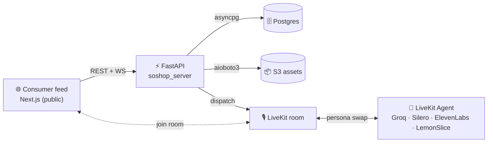

<div align="center">

# SoShop

**A demo of AI-hosted live shopping, built on [LemonSlice](https://lemonslice.com).**

Every "video" in the feed is a real, live video room hosting an AI presenter who can pitch a product, demo it, answer questions, and close the sale. Swipe to swap presenters. The card drops in at the right beat. The presenter never stops talking.

This repository is a reference implementation. It shows what live selling looks like when the host is a LemonSlice avatar instead of a person with a ring light.

[](LICENSE)
[](server/)
[](server/)
[](web/)
[](web/)
[](server/)
[](https://lemonslice.com)

</div>

---

## Table of contents

- [What it looks like](#what-it-looks-like)
- [Why this exists](#why-this-exists)
- [What's in the box](#whats-in-the-box)
- [Architecture](#architecture)
- [The three ideas worth stealing](#the-three-ideas-worth-stealing)
- [Quick start](#quick-start)
  - [`server/`: FastAPI + LiveKit agent](#server-fastapi--livekit-agent)
  - [`web/`: Next.js consumer feed](#web-nextjs-consumer-feed)
- [How the pieces talk](#how-the-pieces-talk)
- [Add or swap a host](#add-or-swap-a-host)
- [The timing trick behind the product card](#the-timing-trick-behind-the-product-card)
- [What this demo is, and what it is not](#what-this-demo-is-and-what-it-is-not)
- [Contributing](#contributing)
- [License](#license)

---

## What it looks like

Open the feed and you land in a full-bleed vertical video, the format your thumb already knows. The host is talking to you. She names a product, gives you a reason to care, and a card slides up with a price and a Buy button right as the pitch hits its peak. Swipe up and a different host is mid-sentence on a different product. Nobody buffered. Nothing redispatched. The room stayed live the whole time.

That is the whole pitch: the shopping channel, but every channel is an AI host who is always on, always on-brand, and answers when you talk back.

<!-- Drop a screen recording or GIF of the feed here. A 10 to 15 second clip of a swipe-driven persona swap with the product card landing tells this story far better than the paragraph above. -->

---

## Why this exists

Live selling works. Whatnot, TikTok Shop, and the QVC playbook all prove that a human talking about a product in real time converts better than a static listing. The catch is that humans do not scale. They need scripts, studios, schedules, and sleep.

LemonSlice makes the host part scale. This demo wires a LemonSlice avatar into a real-time voice pipeline and a commerce backend so you can see the full loop end to end: a presenter that talks, a feed that swipes, and a card that converts. If you are evaluating LemonSlice for a live-commerce product, this is the working example you clone, run, and take apart.

---

## What's in the box

Two independent subsystems sharing one repo. They are coupled by a REST and WebSocket API plus a shared LiveKit room, not by shared code. There is no root `package.json` or `pyproject.toml`, and no Turborepo or Nx. Pick a directory and work in it.

| Subsystem | Path | Stack |
|---|---|---|
| Backend API + LiveKit agent | [`server/`](server/) | Python 3.11, FastAPI, asyncpg, [`uv`](https://docs.astral.sh/uv/) |
| Consumer feed | [`web/`](web/) | Next.js 15 (App Router), React 19, Tailwind |

The interesting code lives in `server/`: the LiveKit agent that drives the avatar, swaps personas in place, and rotates channels when a pitch finishes speaking. The `web/` app is the surface you actually look at.

---

## Architecture



The voice and video pipeline is the part that matters for a live-selling evaluation:

| Stage | Provider | Job |
|---|---|---|
| Speech in | Groq | Speech to text |
| Brain | Groq | The host's responses and product knowledge |
| Turn-taking | Silero | Voice activity detection |
| Speech out | ElevenLabs | Text to speech |
| Face | **LemonSlice** | The talking avatar, swapped live |

Postgres holds the personas, products, campaigns, and budgets. The app runs open access, with no external auth provider. Assets live in an S3-compatible bucket (Tigris in production, MinIO for local dev).

---

## The three ideas worth stealing

Most of this repo is ordinary FastAPI and Next.js. Three pieces are not, and they are the reason the experience feels live instead of like a chatbot wearing a face.

**1. In-place persona swap.** When you swipe, the feed does not tear down the room and dispatch a fresh agent. It sends a control message to the running agent, which interrupts the current speech, reloads the new persona, voice, and avatar from Postgres, and starts the new opening line. One room, one session, presenter changes underneath you. Redispatch still exists as a fallback for when an in-place swap fails.

**2. Completion-driven rotation.** The always-on channels do not rotate on a wall-clock timer. The orchestrator waits for the host to actually finish the sentence (it awaits the `SpeechHandle` from the agent's reply), adds a small random pause so it does not feel robotic, then queues the next presenter. A configured duration still exists, but only as a safety ceiling that force-rotates if the model or the voice hangs. The result is no dead air and no presenter cut off mid-word.

**3. A product card timed to the pitch, not to the model.** The card that pins during a pitch is scheduled server-side, not left to the language model to remember. More on why below, because the timing is the whole point.

---

## Quick start

### Everything in Docker (easiest)

With only Docker installed, one command builds and runs Postgres, LiveKit, the API, the agent worker and the web app, applies the migrations and seeds the demo host:

```bash
cp soshop.env.example soshop.env   # add GROQ_API_KEY
docker compose up -d --build
# open http://localhost:3000/studio
```

On Windows, double-click `soshop-start.cmd` instead: it starts Docker Desktop, asks for the Groq key on first run, and opens the studio. `soshop-stop.cmd` stops the stack and keeps the data. The end-user guide (Vietnamese) is [HUONG-DAN.md](HUONG-DAN.md). To ship to users without the source, `tools/build-release.ps1` builds the images (server code as bytecode only), pushes them to GHCR and writes `dist/SoShop-<version>.zip`, a bundle with no `docker-compose.override.yml`, so it pulls instead of building. All services share one network namespace so `localhost` means the same thing to the browser, the worker and LiveKit; see the header of [docker-compose.yml](docker-compose.yml).

### Per subsystem, for development

Each subsystem has its own `.env.example`. Copy it, fill in your keys, and run. You need accounts for the providers in the pipeline above (LiveKit, LemonSlice, ElevenLabs, Groq) plus Postgres and an S3-compatible bucket. For a first local run you can point S3 at MinIO.

### `server/`: FastAPI + LiveKit agent

Python 3.11, managed by [`uv`](https://docs.astral.sh/uv/). Raw SQL against Postgres (no ORM, no migrations framework; numbered `.up.sql` / `.down.sql` files applied with `psql`).

```bash
cd server
cp .env.example .env          # fill in LiveKit, LemonSlice, ElevenLabs, Groq, Postgres, S3 keys
uv sync
uv run uvicorn soshop_server.api.app:app --port 8000

# In a second terminal, run the agent worker that drives the avatar:
uv sync --group agent
uv run python -m soshop_server.agent.main dev
```

On a fresh database, apply the schema, then seed the brand-free demo host and catalog so the feed has something to play:

```bash
psql "$DATABASE_URL" -f migrations/0001_initial_schema.up.sql
uv run python scripts/seed_v1.py   # needs DATABASE_URL; see server/README.md for the DB walkthrough
```

| Task | Command |
|---|---|
| Test (hermetic by default) | `uv run pytest` |
| Lint + format | `uv run ruff check && uv run ruff format` |
| Type check | `uv run mypy src/` |

Tests are hermetic out of the box. The suite hits zero external services unless you explicitly set `DATABASE_URL` and `BUCKET_NAME`, which opt in to the live integration tests. See [`server/README.md`](server/README.md) for the full setup, including the one-line MinIO and Postgres walkthroughs.

### `web/`: Next.js consumer feed

Next.js 15 App Router. The consumer feed at `/` is public. There is no external auth provider, so the demo builds and runs with no auth keys (see [`web/CLAUDE.md`](web/CLAUDE.md) for the open-access model).

```bash
cd web
cp .env.example .env.local    # NEXT_PUBLIC_API_BASE_URL
npm install
npm run dev
```

| Task | Command |
|---|---|
| Lint | `npm run lint` |
| Type check | `npm run typecheck` |
| Unit + component tests | `npm test` |
| End-to-end (Playwright) | `npm run test:e2e:install && npm run test:e2e` |
| Production build | `npm run build` |

The brand tokens and the typed API client are committed artifacts, so `npm run dev` runs a plain `next dev` with no codegen step in the way. See [`web/README.md`](web/README.md) for the routing and auth model.

---

## How the pieces talk

A session is one user, one LiveKit room, one agent process, and one persona at a time:

1. The web feed asks the server for a room and an access token.
2. The server dispatches a LiveKit agent into that room with validated metadata (which persona, which script, which product).
3. The agent joins, brings up the LemonSlice avatar and the ElevenLabs voice, and starts the opening line.
4. The user swipes. The web app posts to the server, the server sends a control message on the agent's control channel, and the agent swaps persona in place.
5. When a pitch starts, the server schedules the product card to appear at the right moment (see below), and the user can tap to buy.

The products the presenters pitch come from the seed catalog (`server/seed/catalog.json`, falling back to the committed `catalog.json.example`); see [Add or swap a host](#add-or-swap-a-host).

---

## Add or swap a host

A host is one JSON file plus the products it pitches. The repo ships one brand-free demo host, "Leila", and a matching catalog as `*.example` templates under `server/seed/` (the real data is git-ignored, `.env`-style). To add your own:

1. **Pick a voice and a face.** Grab an ElevenLabs `voice_id` and a public avatar image URL.
2. **Add products to the catalog.** Copy `server/seed/catalog.json.example` to `server/seed/catalog.json` (git-ignored) and add products, each with a unique `sku`, title, price, and image URLs. Or just edit the example in place to change the demo.
3. **Write the persona.** Copy `server/seed/personas/demo-host.json.example` to `server/seed/personas/<your-host>.json` (git-ignored). Set `name`, `voice_id`, `avatar_image_url`, `personality`, and at least 10 `scripts`, each with a `product_sku` from your catalog and a hook + body + CTA in the 30 to 45 word band.
4. **Validate and seed.**
   ```bash
   cd server
   uv run pytest tests/seed          # enforces the word band + that every SKU resolves
   uv run python scripts/seed_v1.py  # upserts the data and binds personas to channels
   ```
5. **Put it on air.** The live channel reconciler binds the **active** personas (`status: "active"`) to channels by name order, one per channel, up to `CHANNEL_COUNT` (default 1). The seeder writes the persona rows; the reconciler is what selects which ones air. After seeding, apply the binding with `POST /admin/channels/reconcile` (admin-gated). With the agent worker running, `GET /channels` then returns your host.

**To swap the current host out**, set the old host's `status` to `"paused"` and the new one's to `"active"` in their JSON, re-seed, and reconcile (`POST /admin/channels/reconcile`). With `CHANNEL_COUNT=1`, channel 0 airs the alphabetically-first active host; if name order does not pick yours, point the channel at it directly:

```sql
UPDATE channels SET persona_id = (SELECT id FROM personas WHERE name = '<New Host>') WHERE ordinal = 0;
```

See [`server/seed/personas/README.md`](server/seed/personas/README.md) for the full persona schema and the word-count contract.

---

## The timing trick behind the product card

This is the part people ask about, so it gets its own section.

The product card is pinned **during** the pitch, not before and not after. The timing is server-driven, not model-driven. When a pitch starts, at dispatch and after every swap, the agent schedules a deterministic auto-show that fires the card about 2.5 seconds in, by which point the host has named the product and landed a hook. The model still has a `signal_product_pitch()` tool wired up as a safety net: a call before the scheduled time defers to it, a call after is a no-op. So the card never raises at hook time, and it never fails to appear if the model forgets the beat.

Once it is up, the card dwells full-width at the bottom for about three seconds, then auto-collapses to a small pill so the host's face reclaims the screen.

Why bother with the choreography? Three reasons, and they all land at the same instant of peak intent:

- **Curiosity gap.** For a beat the viewer imagines the product before the card confirms it.
- **Dual coding.** The audio carries warmth and conviction while the card carries price and the tap-to-buy affordance. Two channels, one moment.
- **Parasocial frame intact.** The host is doing the selling. The card is just the receipt.

Completion-driven rotation guarantees the close lands in the same emotional beat the host built, with no orphaned cards and no mid-sentence cutoff. You can read the implementation in `server/src/soshop/agent/tools.py` (the auto-show) and `web/components/live/PinnedProductCard.tsx` (the dwell-then-collapse).

---

## What this demo is, and what it is not

**It is** a reference implementation: a working, end-to-end example of AI-hosted live selling that you can clone, run, and take apart. The interesting parts are the live pipeline and the three ideas above. The point is to make those legible, not to hand you a turnkey store.

**It is not** a production system. The consumer feed runs open access, with no real authentication. There is no payment processing behind the Buy button, no moderation on the generated pitches, and no horizontal-scale story for the agent worker. The provider keys, rate limits, and persona catalog are demo defaults. Treat it as a starting point you harden, not a product you deploy.

---

## Contributing

Issues and pull requests are welcome. This is a demo, so the bar is "does it make the example clearer or more useful," not "does it add a feature for production." See [CONTRIBUTING.md](CONTRIBUTING.md) for the workflow. Please report anything security-sensitive privately rather than in a public issue.

A few conventions that keep the repo sane:

- Work in one subsystem at a time, and use its `CLAUDE.md` for the local conventions.
- Let the linters be the style guide. Ruff for `server/`, the Next.js and TypeScript tooling for `web/`.
- Keep secrets out of git. Every subsystem reads from a git-ignored `.env`; only the `.env.example` files are committed.

## License

[MIT](LICENSE). Built by [LemonSlice](https://lemonslice.com). Use it, fork it, learn from it, ship something.
